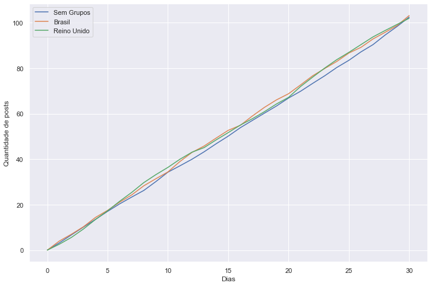
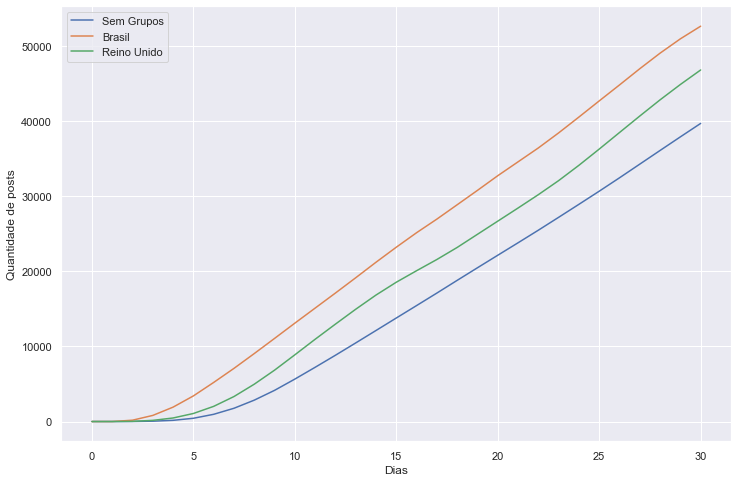

# Espalhamento de Fakenews - Um modelo de simulação do impacto do uso de WhatsApp na propagação de informações

Este repositório contém o código e resultados de um modelo para demonstrar como o espalhamento de informação se dá em vários contextos diferentes de países distintos. O código foi criado por Eric Araújo, e quaisquer dúvidas podem ser enviadas para eric@ufla.br.

O modelo considera que um grupo de 1.000 (mil) pessoas está conectado por meio de uma rede social que simula o uso do WhatsApp. Esta rede considera que a distribuição das conexões das pessoas segue um modelo [Small-world](https://pt.wikipedia.org/wiki/Redes_de_pequeno_mundo). Este modelo é utilizado para descrever redes de influência social, motivo pelo qual utilizaremos este modelo aqui.

Este código serve única e exclusivamente para fins didáticos. Dados reais não foram utilizados para validar o modelo.

Cada pessoa em nossa rede apresenta uma opinião política, que varia de -1 a 1. O valor de -1 indica uma opinião mais à esquerda, e 1 seria uma opinião mais à direita. valores próximos de 0 indicam centristas.

Quando uma postagem é gerada por um indivíduo na rede, seus vizinhos terão acesso à informação, e decidirão se compartilharão ou não baseado em um método estocástico, onde a probabilidade de compartilhamento é maior caso a informação esteja mais alinhada com o seu posicionamento, simulando assim o viés de confirmação.

Serão 3 cenários testados.

1. O cenário brasileiro.
2. O cenário britânico.
3. Um cenário onde não existem grupos públicos, e as pessoas só têm acesso à informação de seus vizinhos.

Segundo pesquisa da [Reuters 2019](https://reutersinstitute.politics.ox.ac.uk/sites/default/files/inline-files/DNR_2019_FINAL.pdf):

* 53\% da população usa WhatsApp como rede principal para discutir e compartilhar notícias.
* 58\% dos usuários de WhatsApp fazem parte de grupos com pessoas que eles não conhecem (12\% no Reino Unido)
* 18\% dos usuários brasileiros de WhatsApp discutem notícias e política em grupos públicos (2\% no Reino Unido)
* 22\% dos usuários de Facebook se apoiam em informações de grupos públicos e privados com desconhecidos para se informar sobre política e das notícias (8\% no Reino Unido).

Desta forma, para os cenários 1 e 2 consideramos a porcentagem de pessoas que fazem parte de grupos públicos ao conectar indivíduos que não são conhecidos nas mesmas proporções levantadas pela pesquisa da Reuters 2019. Para o cenário 3, não existirão grupos públicos/privados para compartilhamento de informação.

## Criando grupos públicos

Grupos públicos são criados a partir da afinidade entre os agentes. Dessa forma, 3 grupos públicos serão criados, considerando a partir do posicionamento político das pessoas. A ideia é que a porcentagem de pessoas em um grupo corresponda ao valor acima, 22\% para os brasileiros, e 8\% para os britânicos.

## Modelo de geração de postagens

Baseado nas estatísticas do Facebook disponíveis pela [OMNICORE](https://www.omnicoreagency.com/facebook-statistics/), o Facebook tem:

* 55 milhões de updates (postagens) por dia.
* 1.59 bilhões de usuários ativos diariamente.

Desta forma, consideramos que a chance de um usuário criar uma nova postagem é de 55 milhões em 1.59 bilhões, ou 0.034\% de chances de fazer uma postagem.

Cada membro da rede poderá gerar uma postagem a cada passo do modelo com probabilidade de 0.034%. Essa postagem conterá um valor referente à carga política (ou viés político) do conteúdo. Para tal, usaremos uma distribuição normal com desvio padrão de 0.1 da posição do agente.

## Modelo de decisão de compartilhamento

O usuário irá verificar a sua concordância com a postagem criada por meio da verificação da diferença entre o conteúdo do post e sua opinião pessoal. Esse cálculo é feito considerando a seguinte fórmula:

$$chance = \left(1 - \frac{|pos\_pessoa - pos\_post|}{2}\right) \times age$$

A posição do agente é dada por *pos_pessoa*, e a posição da postagem por *pos_post*. A diferença é divida por 2 (a maior diferença possível em nossa escala) e multiplicada pelo fator de envelhecimento da postagem (age). Um post recém criado tem 100\% de chances de ser compartilhado, um post do dia anterior 75\%, de dois dias atrás 50\%, três dias atrás 25\% e post mais antigos do que isso são eliminados do sistema.

## Medidas de espalhamento

Para mensurar o alcance das mensagens, contabilizaremos quantas vezes cada mensagem foi propagada.

---

## Estrutura do repositório

```
.
├── Modelo.nlogo                  # Modelo de simulação (NetLogo 6.1.1), inclui o experimento BehaviorSpace
├── Results_Notebook.ipynb        # Notebook principal de análise dos resultados
├── Resultados_Gazeta.ipynb       # Recorte da análise usado para a matéria da Gazeta
├── lib/
│   ├── get_df.py                 # Carrega e consolida os CSVs do BehaviorSpace em DataFrames
│   ├── ibge.py                   # (legado) extração de dados do Censo IBGE 2010 para Lavras
│   ├── inep.py                   # (legado) extração de dados do Censo INEP 2018 para Lavras
│   └── _old_functions.py         # (legado) funções antigas removidas de ibge.py
├── results/run1/                 # Saída bruta do BehaviorSpace
│   ├── Modelo experiment-table.csv
│   └── Modelo experiment-spreadsheet.csv
├── imgs/                         # Figuras geradas pelos notebooks
├── requirements.txt              # Dependências diretas (versões atuais)
└── environment-frozen-2020.txt   # Ambiente exato usado nas execuções de 2020
```

## Como executar o modelo

O modelo foi desenvolvido em [NetLogo 6.1.1](https://ccl.northwestern.edu/netlogo/) e depende da extensão `nw` (network), distribuída junto com o NetLogo.

1. Abra `Modelo.nlogo` no NetLogo.
2. Ajuste os parâmetros na interface.
3. Clique em `setup` e depois em `go`.

### Parâmetros

| Parâmetro | Tipo | Descrição |
|---|---|---|
| `num-users` | slider | Número de agentes na rede (1000 nas execuções publicadas) |
| `fakenews-rate` | slider | Percentual de postagens geradas que são fakenews (10 nas execuções publicadas) |
| `perc-public-groups` | slider | Percentual da população que participa de grupos públicos (8 = Reino Unido, 22 = Brasil) |
| `public-groups?` | switch | Habilita os grupos públicos. Desligado = cenário 3 |
| `graphics?` | switch | Desenha a rede na view. Desligue para execuções em lote (mais rápido) |
| `debug?` | switch | Imprime informações de depuração no console |

### Reproduzindo o experimento

O experimento usado para gerar `results/run1/` está salvo dentro do próprio modelo
(`Tools > BehaviorSpace > experiment`). Ele executa **10 repetições** de cada combinação de
`public-groups?` (true/false) × `perc-public-groups` (8/22), com `num-users = 1000` e
`fakenews-rate = 10`, limitadas a **30 passos**, coletando métricas a cada passo —
40 execuções e 1.240 linhas de dados no total.

Exporte os resultados como *table* para `results/run<N>/` mantendo o sufixo `-table.csv`
no nome do arquivo; `lib/get_df.py` lê todos os arquivos que casem com esse padrão.

## Como reproduzir a análise

```bash
python -m venv .venv
source .venv/bin/activate          # Windows: .venv\Scripts\activate
pip install -r requirements.txt
jupyter notebook Results_Notebook.ipynb
```

Os notebooks devem ser executados a partir da **raiz do repositório**, já que
`lib/get_df.py` procura os resultados no caminho relativo `./results/run1/`.

Carregando os dados diretamente:

```python
from lib.get_df import Results

results = Results()
results.all_df          # DataFrame com todas as execuções consolidadas
results.get_scenarios_step()
```

O `Results` renomeia as colunas do NetLogo para nomes utilizáveis em Python
(`count posts with [fakenews? and shared?]` → `fakenews_shared`, e assim por diante) e
adiciona a coluna `db`, que identifica de qual arquivo CSV cada linha veio.

## Resultados





A análise completa, com a comparação entre os três cenários, está em `Results_Notebook.ipynb`.

## Problemas conhecidos

Estes pontos foram identificados ao revisar o repositório e estão registrados aqui para
quem for retomar o projeto. O código foi mantido como estava para não alterar os
resultados já publicados.

* **`Results.get_scenarios_step()` trunca o cenário sem grupos públicos.** Como
  `public-groups? = false` foi executado com os dois valores de `perc-public-groups`, esse
  cenário tem 620 linhas, contra 310 dos demais. As colunas são montadas atribuindo `pd.Series`
  a um DataFrame já indexado, então a série mais longa é cortada silenciosamente para 310
  linhas — metade dos dados do cenário 3 é descartada. Ao retomar a análise, vale desduplicar
  as execuções de `public-groups? = false` ou usar `pd.concat(..., axis=1)`.
* **`get_opinions()` e `get_perc_lockdown()` em `lib/get_df.py` não se aplicam a este
  projeto.** Elas esperam colunas `beta`, `sigma`, `opinion_avg` e `num_lockdown`, que não
  existem neste conjunto de dados (são resquícios de outro modelo) e falham com
  `AttributeError` se chamadas.
* **`lib/ibge.py`, `lib/inep.py` e `lib/_old_functions.py` são legado.** Vieram do trabalho
  com dados censitários de Lavras, não são importados por nenhum notebook deste repositório e
  dependem de um diretório `data/` que não é distribuído aqui (veja os links do
  [IBGE](https://www.ibge.gov.br/estatisticas/downloads-estatisticas.html) e do
  [INEP](http://portal.inep.gov.br/web/guest/microdados) nos cabeçalhos dos arquivos).
  Foram mantidos por valor histórico.

## Ambiente

As execuções originais são de julho de 2020. `environment-frozen-2020.txt` preserva o
`pip freeze` daquele ambiente. O `requirements.txt` atual lista apenas as dependências
diretas, com versões mínimas, e foi verificado em Python 3.14 com pandas 3.0 — o
carregamento dos resultados em `lib/get_df.py` continua funcionando sem alterações.
